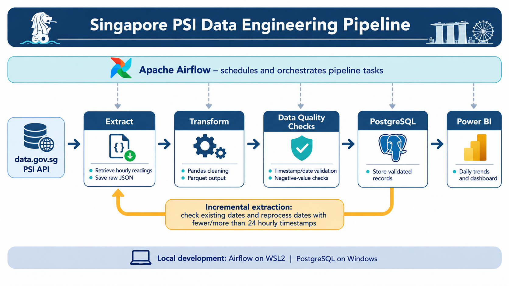
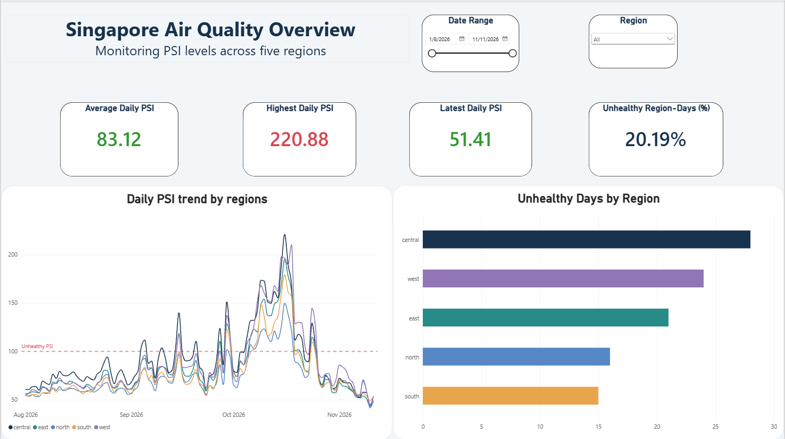
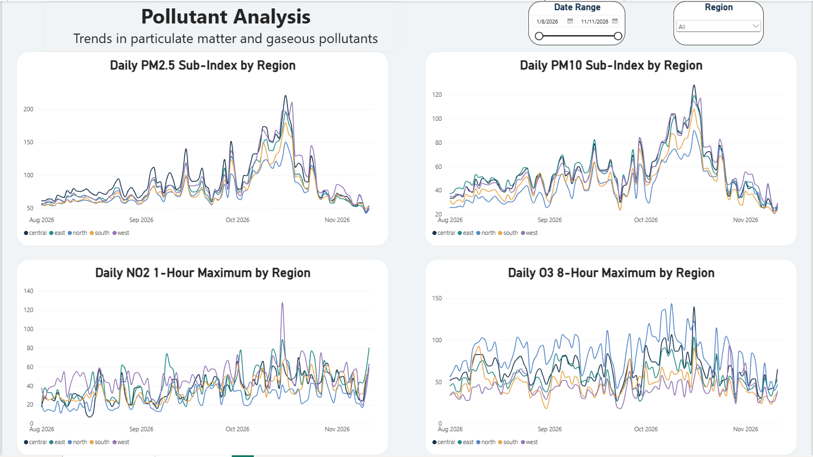

# Singapore PSI Data Engineering Pipeline

An end-to-end data engineering project that extracts Singapore's air quality data from the **data.gov.sg API**, transforms and validates the data using Python, stores it in PostgreSQL, and presents insights through an interactive Power BI dashboard.

The project demonstrates a practical ETL workflow using **Apache Airflow, Python, Pandas, Parquet, PostgreSQL and Power BI**.

---

## 📌 1. Problem Statement

Air quality is an important environmental and public health indicator. However, raw air quality data is not always immediately suitable for analysis and reporting.

The objective of this project was to build an automated data pipeline that:

- Extracts Singapore air quality data from a public API.
- Transforms raw JSON data into a structured format.
- Performs data quality checks before loading.
- Stores validated data in a PostgreSQL database.
- Makes the data available for analysis and visualisation through Power BI.

The project also incorporates incremental extraction and reprocessing logic to identify dates with incomplete hourly data.

## 📂 2. Data Source & Preparation

### 2.1 Data Source

The data is obtained from Singapore's Government open data platform:

- **Source:** [data.gov.sg](https://data.gov.sg/)
- **Dataset:** Singapore Pollutant Standards Index (PSI)
- **Data format:** JSON
- **Frequency:** Hourly readings

The dataset contains air quality measurements across Singapore's five regions:

- Central
- East
- North
- South
- West

The metrics include:

- 24-hour PSI
- PM2.5 Sub-Index
- PM10 Sub-Index
- NO2 1-Hour Maximum
- O3 8-Hour Maximum

### 2.2 Data Preparation

The raw API responses are initially saved as JSON files before being processed.

Using Python and Pandas, the data is transformed into a structured tabular format. The transformed data is then saved as Parquet files before being loaded into PostgreSQL.

This separates the raw data extraction stage from the transformation and loading stages.

## ⚙️ 3. Pipeline Architecture & Process

### 3.1 Pipeline Architecture

The pipeline is orchestrated using Apache Airflow, which schedules and manages the execution of the ETL tasks.

### 3.2 Extraction

The extraction process retrieves hourly air quality readings from the data.gov.sg API.

Before making API requests, the pipeline queries PostgreSQL to check which dates have already been loaded.

The pipeline uses the following logic:

- Checks the existing data in PostgreSQL.
- Identifies dates that do not have the expected 24 distinct hourly timestamps.
- If the database table does not exist, performs an initial historical extraction from 1 August 2026 to the previous day.
- Passes the identified dates to the extraction task.
- Retrieves the corresponding data from the API.
- Saves the raw API responses as JSON files.
- Introduces a two-second delay between consecutive API requests.

This approach avoids repeatedly extracting dates that are considered complete, while allowing dates with incomplete hourly data to be reprocessed.

### 3.3 Transformation

The raw JSON responses are processed using Python and Pandas.

The transformation process includes:

- Reading the extracted JSON files.
- Reshaping the data into a structured tabular format.
- Preparing the data for downstream validation and loading.
- Saving the transformed output as Parquet files.

### 3.4 Data Quality Checks

Data quality checks are performed before loading the transformed data into PostgreSQL.

The validation checks include:

- **Future timestamp validation:** Checks that timestamps do not exceed the current Singapore date and time.
- **Future date validation:** Checks that the data dates are not in the future.
- **Updated timestamp validation:** Checks that updated timestamps do not exceed the current Singapore date and time.
- **Negative value validation:** Checks that measurement values are not negative.

If a data quality check fails, the pipeline raises an error and stops the downstream loading process.

### 3.5 Loading

After passing the data quality checks, the transformed data is loaded into PostgreSQL.

The loading process includes:

- Creating the database and table when required.
- Loading the validated records into PostgreSQL.
- Using a unique constraint on timestamp, metric and region to prevent duplicate combinations.
- Using conflict handling to avoid inserting duplicate records.
- Replacing existing records for dates being reprocessed.

This allows the database to retain historical data while supporting the reprocessing of incomplete dates.

### 3.6 Orchestration

Apache Airflow manages the execution and dependencies between the ETL tasks.

The workflow consists of:

1. Identify dates requiring extraction.
2. Extract data from the API.
3. Transform the raw data.
4. Perform data quality checks.
5. Load validated data into PostgreSQL.

The DAG is scheduled to run daily, with task dependencies ensuring that downstream tasks only run after their upstream tasks succeed.

### 3.7 Visualisation

Power BI connects to PostgreSQL to retrieve the processed data.

The dashboard presents air quality trends and pollutant measurements through interactive visuals, allowing users to explore the data by date and region.

## 🛠️ 4. Technologies Used

| Technology | Purpose |
|---|---|
| Python | ETL development and data processing |
| Pandas | Data transformation and manipulation |
| Apache Airflow | Workflow orchestration and scheduling |
| PostgreSQL | Relational database for storing processed data |
| Parquet | Storage format for transformed data |
| Power BI | Dashboard development and data visualisation |
| WSL2 (Ubuntu) | Local development environment |

## 🧩 5. Challenges & Problem-Solving

### 5.1 Tool Compatibility and Environment Integration

**Problem:**

During development, I encountered integration challenges when working with different tools and operating environments.

- Initially developed and tested Python code in Jupyter Notebook, but needed to reorganise the code into reusable `.py` modules for Airflow to import and execute.
- Ran Apache Airflow inside WSL2 (Ubuntu) while PostgreSQL was installed on Windows, requiring additional network and connection configuration.

**What I did:**

- Converted the notebook-based development logic into Python modules to support Airflow integration.
- Configured PostgreSQL and Windows Firewall settings to allow connections from the WSL2 environment.
- Identified the Windows host IP address accessible from WSL2 and tested connectivity between Airflow and PostgreSQL.

**Outcome & Learning:**

Successfully integrated Airflow with PostgreSQL across the two operating environments.

This experience highlighted the importance of considering tool compatibility, execution environments and integration requirements when designing a data pipeline. I also recognised that alternative setups, such as Docker Compose, could provide a more consistent and reproducible development environment.

### 5.2 Handling Incomplete Data and Reprocessing

**Problem:**

Simply extracting new dates would not address situations where previously loaded dates contained incomplete hourly data. This could result in gaps in the historical dataset.

**What I did:**

- Implemented a completeness check that queries PostgreSQL to identify dates with fewer or more than the expected 24 distinct hourly timestamps.
- Used the query results to determine which dates required re-extraction.
- Integrated this check into the Airflow workflow before the extraction task.
- Used database constraints and conflict handling to reduce duplicate records during reprocessing.

**Outcome:**

The pipeline can identify dates with an unexpected number of hourly timestamps and selectively reprocess them instead of repeatedly extracting the entire historical dataset.

### 5.3 Data Quality Validation

**Problem:**

Loading invalid data into the database could affect the accuracy of downstream analysis and visualisation.

**What I did:**

- Implemented validation checks for future timestamps, future dates and negative measurement values.
- Used logging to record validation failures.
- Configured the pipeline to stop when data quality checks fail, preventing invalid data from proceeding to the loading stage.

**Outcome:**

Introduced a validation step before loading data into PostgreSQL, helping to maintain data quality throughout the pipeline.

### 5.4 Managing API Requests

**Problem:**

Repeated API requests during historical extraction could result in unnecessary requests being sent within a short period.

**What I did:**

- Added a two-second delay between consecutive API requests.
- Used the incremental extraction logic to avoid requesting dates that were already considered complete.

**Outcome:**

Reduced unnecessary API requests and introduced a controlled request interval during extraction.

## 📊 6. Power BI Dashboard & Findings

The Power BI dashboard consists of two pages, providing an overview of Singapore's air quality and a more detailed analysis of individual pollutants.

### 6.1 Page 1 – Singapore Air Quality Overview

This page provides a high-level overview of PSI readings across Singapore.

**Key features:**

- Average Daily PSI
- Highest Daily PSI
- Latest Daily PSI
- Unhealthy Region-Days (%)
- Daily PSI trends across the five regions
- Unhealthy Region-Days by region
- Interactive date and region slicers

The dashboard uses a PSI value above 100 as the threshold for identifying unhealthy readings.

The unhealthy region-day measure counts each date-region combination where the daily average PSI exceeds 100. It does not represent the number of unique calendar days Singapore experienced unhealthy air quality.

### 6.2 Page 2 – Pollutant Analysis

This page focuses on the trends of four individual pollutants:

- PM2.5
- PM10
- Nitrogen Dioxide (NO2)
- Ozone (O3)

**Key features:**

- Daily pollutant trends across Singapore's five regions.
- Region filtering to examine individual regional trends.
- Date filtering to explore changes over time.

The dashboard uses daily averages to make longer-term trends easier to examine.

For NO2 and O3, the source measurements represent hourly or rolling-period maximum readings. Therefore, their daily averages should be interpreted as averages of the reported readings, rather than daily maximum pollutant concentrations.

## 💡 7. Business Implications

Although this project focuses on environmental data, the resulting information could support operational planning and decision-making.

Some potential applications include:

**Logistics and Supply Chain**

- Monitor air quality conditions when planning outdoor loading and unloading activities.
- Consider alternative arrangements for outdoor delivery operations during periods of poor air quality.
- Improve communication with employees who work outdoors.

**Construction and Outdoor Operations**

- Use air quality information to support decisions on outdoor work schedules.
- Provide additional precautions for workers during periods of unhealthy air quality.

**Facilities and Property Management**

- Monitor air quality trends to support ventilation and air filtration decisions.
- Use regional information to understand where additional attention may be required.

These are potential applications of the data rather than measured business outcomes from this project.

## 🚀 8. Limitations & Future Improvements

There are several areas where the project could be improved further:

- **More comprehensive data quality checks:** Validate missing hourly timestamps and duplicate readings in addition to checking the number of distinct timestamps per date.
- **Improved error handling:** Introduce retry mechanisms for temporary API failures.
- **Containerisation:** Explore Docker Compose to run Airflow and PostgreSQL in a consistent, reproducible environment.
- **Cloud deployment:** Deploy the pipeline to a cloud environment for improved scalability and availability.
- **Monitoring and alerting:** Implement notifications when pipeline tasks fail or data quality checks do not pass.
- **Historical data expansion:** Extend the dataset to support longer-term air quality analysis.

## 🎯 9. Conclusion

This project gave me the opportunity to build an end-to-end data engineering pipeline, from extracting data through an API to transforming, validating, storing and visualising it.

Through this project, I gained practical experience in working with Python, Pandas, Apache Airflow and PostgreSQL, while learning how different components of a data pipeline work together.

More importantly, I gained a better understanding of the challenges involved in handling real-world data, including incomplete records, data validation, API request management, database connectivity and tool integration.
